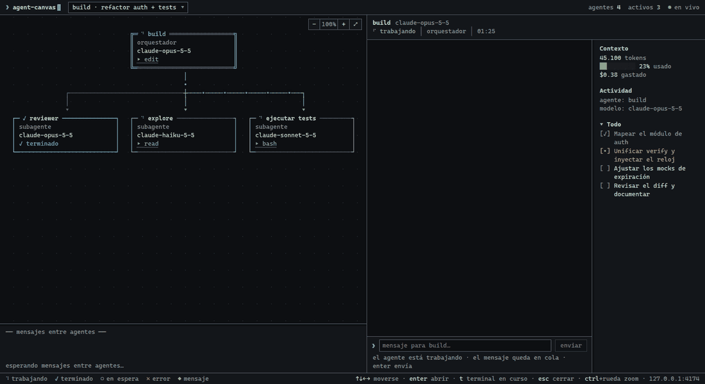
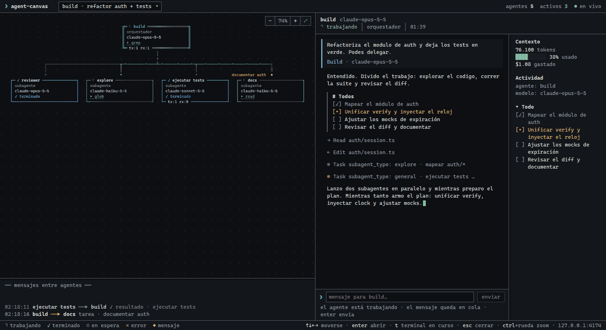
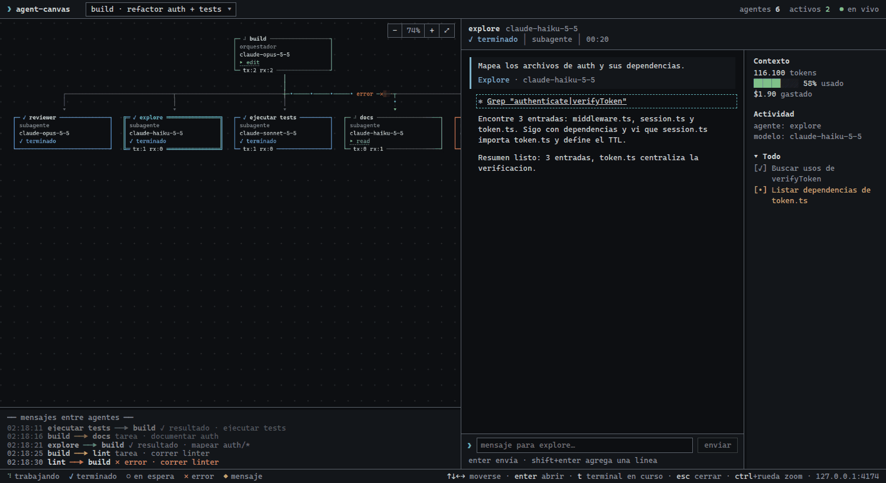
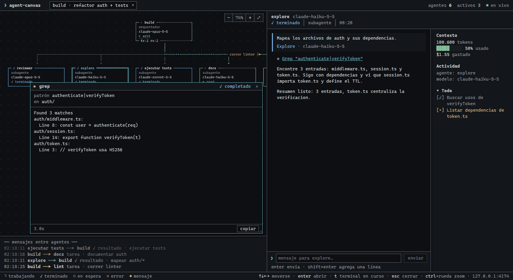

# claude-agent-team

Marketplace de Claude Code llamado `gael-tools` con dos plugins:

- **agent-team**: un equipo de agentes para desarrollo (tech-lead, especialistas, QA y revisión) con skills propias.
- **agent-canvas**: un panel local que muestra en vivo qué están haciendo los agentes y subagentes de una sesión de Claude Code.

No es un framework ni una herramienta que se ejecute sola: son definiciones de agentes, skills, hooks y un servidor local que Claude Code carga cuando instalás los plugins.



| Vista general | Chat de un subagente | Detalle de una herramienta |
| --- | --- | --- |
|  |  |  |

> Las imágenes son de la demo con datos simulados. El canvas de Claude Code usa la misma interfaz que el de OpenCode; la diferencia es que acá la caja de mensajes está deshabilitada (Claude Code no permite escribirle a una sesión abierta desde afuera).

## Requisitos

- Claude Code instalado.
- Node 18 o superior, solo para `agent-canvas` (el servidor y los hooks son Node). `agent-team` no necesita Node.

## Instalación

Dentro de Claude Code:

```text
/plugin marketplace add GaelSchenone/claude-agent-team
/plugin install agent-team@gael-tools
/plugin install agent-canvas@gael-tools
```

Después de instalar, los agentes aparecen con el prefijo del plugin: `agent-team:tech-lead`, `agent-team:backend`, etc.

## Agentes de agent-team

El punto de entrada es el **tech-lead**: entiende el pedido, arma un plan por olas, elige el nivel de cada tarea, delega y integra. No escribe código de la aplicación.

- **explorer**: mapea el código existente en solo lectura (estructura, convenciones, comandos).
- **architect**: fija los contratos de API y de datos y registra las decisiones técnicas.
- **backend**: implementa API, lógica de negocio e integraciones.
- **backend-deep**: variante para autenticación, permisos, pagos, concurrencia y rendimiento; usa el modelo del agente principal.
- **frontend**: implementa interfaces a partir de los tokens y mockups de `design/`.
- **database**: diseña esquemas, escribe migraciones y optimiza consultas. No ejecuta migraciones contra bases reales.
- **database-deep**: variante para migraciones riesgosas, tablas grandes y modelado complejo; usa el modelo del agente principal.
- **qa**: escribe y ejecuta tests, reproduce bugs. No toca el código de la aplicación.
- **reviewer**: revisión de código y seguridad en solo lectura, con veredicto por gravedad.
- **designer**: brief, wireframes, mood board, style guide, tokens y mockups en `design/`.

El tech-lead carga la skill `team-workflow`, que define el protocolo: reparto de carpetas, flujo por olas, cuándo usar el nivel profundo y cómo cerrar una entrega. El resto de las skills (`api-contract`, `db-migrations`, `design-direction`, `frontend-conventions`, `security-checklist`, `test-strategy`) vienen incluidas en el plugin y cada agente carga las suyas.

## Canvas

El canvas es un panel local para mirar el trabajo del equipo. Se abre con:

```text
/agent-canvas:open
```

o, desde la terminal, con `node plugins/agent-canvas/bin/agent-canvas start` y abriendo http://127.0.0.1:7789 en el navegador. Muestra el grafo de agentes y subagentes, la conversación, las herramientas que se ejecutan y un sidebar con contexto, costo y tareas. El puerto se cambia con `AGENT_CANVAS_PORT`.

El servidor escucha **solo en 127.0.0.1**, no guarda nada en disco y rechaza pedidos que no sean locales. Los hooks le mandan los eventos de la sesión a ese servidor local; si el canvas no está corriendo, no hacen nada. Ningún dato sale de tu máquina.

## Tests

```bash
node --test tests/*.test.mjs
```

## Licencia

MIT. Ver [LICENSE](./LICENSE). Titular: Gael Schenone, 2026.
