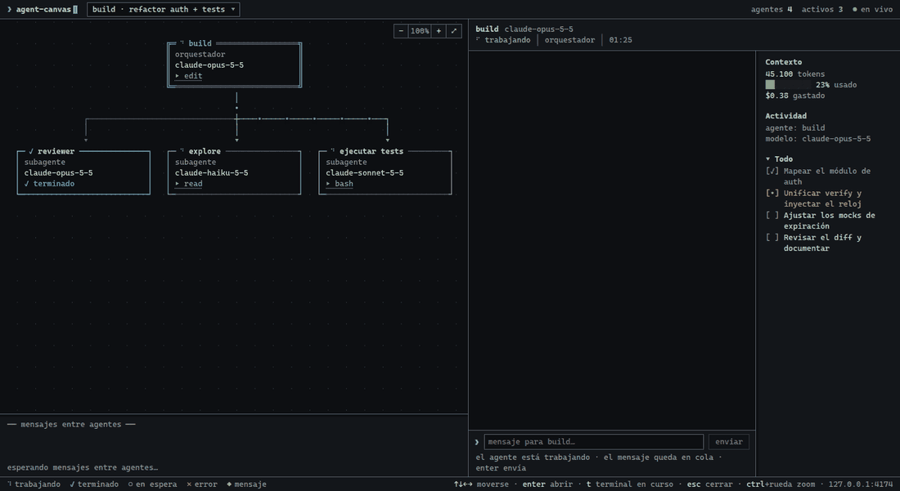
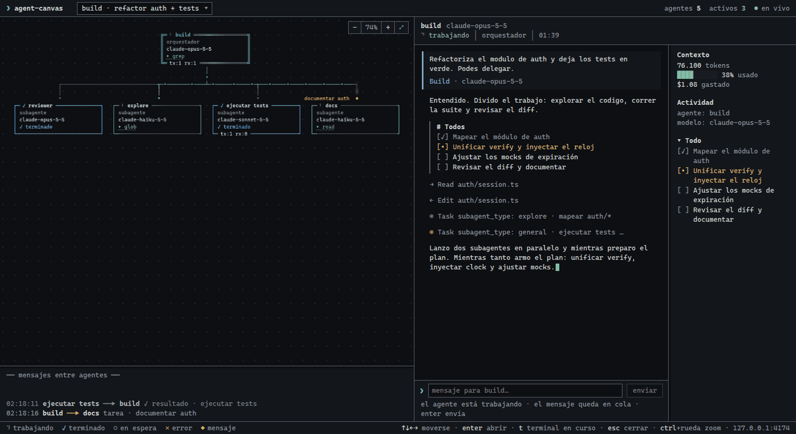
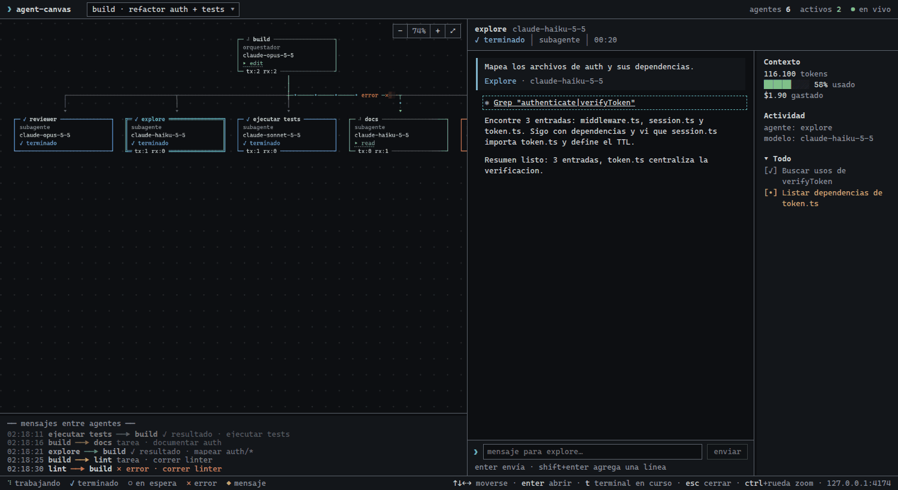
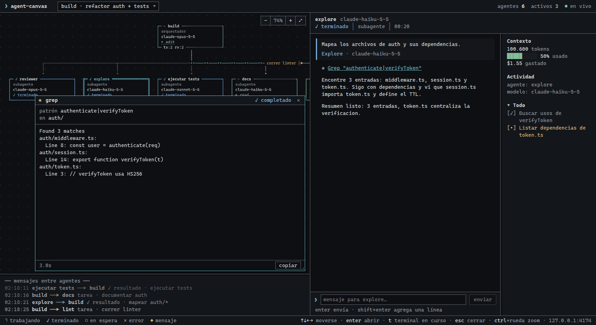

# agent-canvas

Panel local en vivo para mirar qué hacen los agentes y subagentes de una sesión de Claude Code. Los hooks del plugin le mandan los eventos de la sesión a un servidor local y el panel los dibuja en el navegador.



| Vista general | Chat de un subagente | Detalle de una herramienta |
| --- | --- | --- |
|  |  |  |

> Imágenes de la demo con datos simulados (misma interfaz que el canvas de OpenCode). En Claude Code la caja de mensajes está deshabilitada y no hay salida en vivo de herramientas.

Para ver el canvas andando sin gastar una sesión de Claude Code: `node scripts/demo.mjs` y abrí http://127.0.0.1:7790 (datos inventados, dura ~35 s, no toca tu canvas real del puerto 7789).

## Instalación

```text
/plugin marketplace add GaelSchenone/claude-agent-team
/plugin install agent-canvas@gael-tools
```

## Requisitos

Node 18 o superior. `agent-team` no lo necesita, pero el canvas sí.

## Cómo abrirlo

Dentro de Claude Code:

```text
/agent-canvas:open
```

Eso levanta el servidor y te indica la dirección. También se puede arrancar desde la terminal:

```bash
node plugins/agent-canvas/bin/agent-canvas start
```

y abrir http://127.0.0.1:7789 en el navegador. Para detenerlo: `node plugins/agent-canvas/bin/agent-canvas stop`.

El puerto por defecto es 7789 y se cambia con la variable `AGENT_CANVAS_PORT`. Con `AGENT_CANVAS_AUTOSTART=1` el servidor se levanta solo la primera vez que un hook no lo encuentra.

## Qué muestra

- **Grafo de agentes y subagentes**: quién delegó a quién y en qué estado está cada uno.
- **Chat**: la conversación de la sesión y los mensajes entre agentes.
- **Herramientas**: cada llamada a herramienta con su detalle y resultado.
- **Sidebar**: contexto, costo estimado y tareas (todos) del agente seleccionado.

## Privacidad

El servidor escucha **solo en 127.0.0.1**, no guarda nada en disco y rechaza pedidos con un `Host` que no sea local. Los eventos no salen de tu máquina. Si el canvas no está corriendo, los hooks no hacen nada y no afectan la sesión.

## Limitaciones conocidas

- No hay salida en vivo de las herramientas: ves la llamada y su resultado cuando termina, no el stream mientras corre.
- No se pueden enviar mensajes a una sesión abierta desde el panel. Claude Code no lo permite; los mensajes se escriben en la terminal de esa sesión.
- El tamaño de la ventana de contexto no lo informa Claude Code, así que el porcentaje de contexto puede aparecer vacío.
- El costo es una estimación calculada a partir del transcript local.
